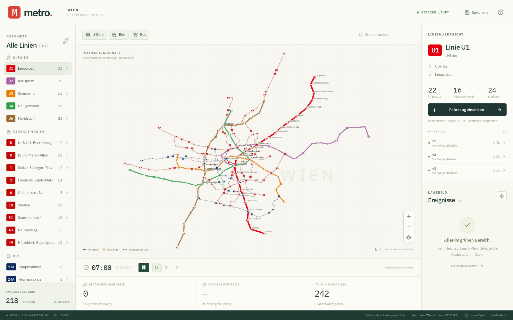

# metro.

**Deine Stadt. Dein Takt.** Eine Wiener Betriebsleitstelle als deutschsprachiges Browserspiel. Du steuerst U-Bahn, Bim und Bus auf einer interaktiven Netzkarte und reagierst auf Andrang, Fahrzeugdefekte und Streckensperren.



## Lokal spielen

Voraussetzung: **Bun 1.4.4 oder neuer** ([Installation](https://bun.com/docs/installation)). Node.js, npm und ein Anwendungsbackend werden nicht benötigt.

```sh
bun install --frozen-lockfile
bun run dev
```

Die Website öffnet sich unter **http://localhost:3000**. Für den optimierten Produktionsbuild:

```sh
bun run build
bun run start
```

`PORT=3001 bun run start` verwendet einen anderen Port. `dist/` enthält die statische Website einschließlich Browser-Worker und eingebetteter Schriften. Eine öffentliche Website wird durch dieses Repository nicht automatisch bereitgestellt.

## Spielen

- Wähle links eine Linie. **Fahrzeug einsetzen** schickt eine passende Reserve mit 90 Sekunden Anfahrtszeit in den Betrieb.
- Wähle ein Fahrzeug im Plan oder in der Fahrzeugliste. Du kannst es 30 Sekunden am nächsten Halt zurückhalten, zum Einrücken schicken, vorzeitig wenden oder auf eine andere kompatible Linie umleiten. Eine Fahrwegvorschau lässt sich bestätigen oder abbrechen.
- Suche Stationen oder klicke sie im Plan an. Orange Wartewolken zeigen stärkeren Andrang; das Detailfenster zeigt die genaue Zahl.
- Über das Blitzsymbol im Lagebild kannst du Fahrgastandrang, einen Defekt oder eine Sperre auslösen. Zufällige Ereignisse kommen während des Betriebs hinzu. Defekte lassen sich nur für ein gerade haltendes Fahrzeug auslösen.
- Bei einer Sperre kannst du eine **Ersatzbuslinie einrichten**. Sie erhält zunächst einen Bus aus der gemeinsamen Busreserve; weitere Busse kannst du über die neue Linie einsetzen. Nach Ende der Sperre rücken sie wieder ein.
- Pause, 1×/2×/5× und die **Leertaste** steuern den Zeitablauf. Mit Mausrad, Ziehen und den Kartenknöpfen verschiebst und vergrößerst du den Plan. Filter blenden Verkehrsmittel aus.

Das Spiel startet um 07:00 Uhr mit laufendem Regelbetrieb und einem festen Fahrzeugbestand. Es gibt keine Geldverwaltung und kein festes Spielende. Die Nachfrage hängt von der Tageszeit ab. Fahrgäste haben Ziele, benötigen Plätze und steigen gegebenenfalls um. Nach 30 Minuten Warten geben sie ihre Fahrt auf. Die Anzeigen erfassen abgeschlossene Fahrten, mittlere Wartezeit bei Einstieg, Wartende und aufgegebene Fahrten.

**Speichern:** Automatisch alle 30 Sekunden und manuell oben rechts, ausschließlich auf diesem Gerät und unter derselben Browseradresse. Ein geladener Betrieb ist pausiert. Während der Abwesenheit vergeht keine Spielzeit. Browserdaten löschen, Privatmodus oder eine andere Adresse können den Zugriff auf den lokalen Spielstand verändern. Ein Speicherfehler wird sichtbar gemeldet.

## Netz und Spielmodell

Alle Haltestellen beider Fahrtrichtungen dieser **18 Linien** sind enthalten, insgesamt **335 zusammengeführte Stationen**:

| Verkehrsmittel | Linien |
| --- | --- |
| U-Bahn | U1, U2, U3, U4, U6 |
| Straßenbahn | D, O, 1, 2, 6, 18, 31, 43, 49 |
| Bus | 13A, 14A, 15A, 48A |

**Datenquelle: Stadt Wien – Wiener Linien, CC BY 4.0**, GTFS-Export vom 26.10.2026, abgerufen am 01.11.2026. Quellen, Datenänderungen, Hash, gewählte Linienvarianten und reproduzierbarer Import stehen in [Datenherkunft](docs/data-sources.md).

Die Baseline kombiniert vollständige Normalvarianten aus dem Export. Sie stellt keinen realen einheitlichen Betriebstag und keinen aktuellen Fahrplan dar. Beispielsweise ist die U2 bewusst bis Karlsplatz enthalten. Reale Baustellenkalender werden nicht automatisch übernommen. Unterschiedliche Hin- und Rückwege bleiben erhalten.

Die U1–U4 haben einen gemeinsamen Fahrzeugpool; die U6 bleibt isoliert. **Fiktive Gleisverbindungen** am Karlsplatz und bei Landstraße sind violett gestrichelt markiert. Straßenbahnwechsel verwenden eine kleine kuratierte Auswahl expliziter Verbindungen; ein Fahrgastumstieg ist keine Gleisverbindung. Bus-Linienwechsel verwenden vereinfachte Oberflächen-Betriebsfahrten zwischen den jeweils nächsten Halten. Ersatzbuskorridore verbinden die Endpunkte des gesperrten Abschnitts oberirdisch. Diese Straßenwege, Wendemanöver, Fahrzeugkapazitäten, Reisezeiten und Nachfrage sind Spielannahmen, keine Infrastrukturfreigabe oder Verkehrsprognose.

## Entwicklung und Prüfung

```sh
bun run typecheck
bun test tests
bun run build
```

Browserprüfung des laufenden Produktionsbuilds in Chromium und Firefox:

```sh
bun --bun node_modules/playwright/cli.js install --with-deps chromium firefox
bun run start
# In einem zweiten Terminal:
bun run test:browser
```

Die Browserinstallation kann Administratorrechte für Linux-Systembibliotheken benötigen. Der Test verwendet Bun als Runtime, fährt beide Browser durch die tatsächliche Oberfläche und prüft standardmäßig je 65 Sekunden bei 5×. Mit `METRO_BROWSER_SECONDS=5` ist ein kürzerer Durchlauf möglich. Berichte und Screenshots landen unter `test-results/` und werden nicht eingecheckt. CI prüft Typen, Simulation, Speicherung, statischen Build und dieselben Browserabläufe.

Die Tests umfassen Fahrzeug- und Fahrgastbilanz, Kapazitäten, inkompatible Fahrwege, Störungen, Ersatzverkehr, Tageszeitnachfrage und deterministisches Fortsetzen. Ein Endurance-Test simuliert das komplette Netz. Technische Tests ersetzen keine fachliche Prüfung realer Gleise, realer Betriebsabläufe oder menschlicher Spielbarkeit.

Die dokumentierten Nachweise der ersten Version stehen unter [Verifikation](docs/verification.md). Zufällige Ereignisse verwenden zunächst Ausgangshalte aus der Hinrichtung; manuell lassen sich auch ausschließlich in der Rückrichtung bediente Stationen auswählen.

Der reine Simulationskern befindet sich in `src/sim/`, alle zentralen Spielparameter in `src/sim/config.ts`. Der Browser-Worker besitzt den Spielzustand. Die React-Oberfläche sendet Befehle und erhält fünf Zustandsbilder pro Sekunde; Fahrzeugbewegungen werden zwischen diesen Bildern interpoliert. IndexedDB speichert Zustand, Ereignisse und Zufallszustand zusammen mit der Netzversion.

## Lizenz

Eigener Programmcode: **[GNU Affero General Public License v3.0 only](LICENSE)** (`AGPL-3.0-only`). Öffentlicher Quellcode: [github.com/mpwg/metro](https://github.com/mpwg/metro).

Die Netzdaten sind separat unter **CC BY 4.0** lizenziert; weitere Bestandteile haben eigene Lizenzen, siehe [Drittbestandteile](THIRD_PARTY_NOTICES.md). Metro ist ein unabhängiges Spielprojekt und kein offizielles Angebot der Wiener Linien.
